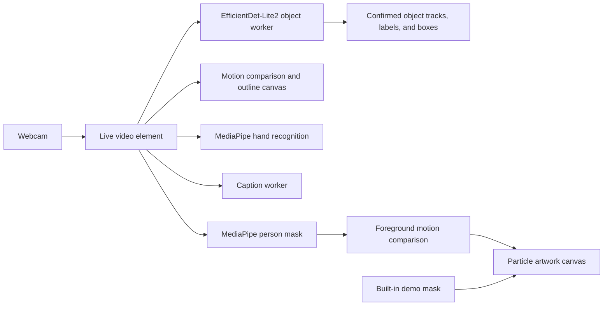

# Webcam Studio code walkthrough

Webcam Studio runs as a static page in the browser. The local Python command serves the files. JavaScript opens the camera, processes frames, and updates the selected tab. You can read the source and explanation side by side in the chapters below.

## Follow a camera frame

When you click **Start camera**, the browser asks for access and supplies a video stream after you allow it. The video element plays and displays the stream in color. Each tab reads frames from that same element. In artwork mode, the artwork canvas takes over the visible preview while the video element supplies frames to the person model.

- **Live detection** starts in **Objects**. A browser worker runs EfficientDet-Lite2 and returns classes, confidence scores, and boxes. JavaScript confirms matching boxes on two samples, smooths their positions, and projects them onto the displayed video. **Motion** compares the brightness of two small frame copies and groups nearby changes into rectangles.
- **Gesture to voice** measures a hold after MediaPipe recognizes one of the demo hand poses. An accepted pose adds a word to the transcript. A button or a hold of two open palms asks the browser to speak the sequence.
- **Scene captions** copies one color frame and gives its pixels to a browser worker. The worker runs the caption model and returns text. The page checks that text for object and action words.
- **Particle artwork** uses an AI confidence map to decide which pixels belong to the person. Frame differencing measures movement inside that mask. Moving points are drawn in gold. The tree, grass, stars, and demo figure come from drawing commands.

## Read the files in this order

| Chapter | Source files | What to look for |
| --- | --- | --- |
| [Page and styles](./walkthrough-interface.md) | `index.html` and `styles.css` | Element IDs connect the controls to JavaScript. CSS places the color video and transparent overlay in the same viewing area. |
| [Camera and app state](./walkthrough-camera.md) | `app.mjs` | Start at `startCamera`, follow `tick`, then read the handler for the mode you want to understand. |
| [Detectors, gestures, and captions](./walkthrough-vision.md) | `object-detection.mjs`, `object-worker.js`, `motion.mjs`, `gestures.mjs`, `mediapipe.mjs`, `caption-worker.mjs`, and the detector tests | Trace how worker results, pixels, landmarks, and image snapshots become the results shown in the interface. |
| [Particle artwork](./walkthrough-artwork.md) | `particle-art.mjs` | Follow `capture` to see how the model produces a mask and how pairs of masks reveal movement. Read `drawSilhouette` to see how both results become colored points. |

The tables use the actual source line numbers and include closing tags, braces, and other structural lines. Blank lines separate code blocks and have no table row. Start with the file and function relevant to what you see on the screen.
